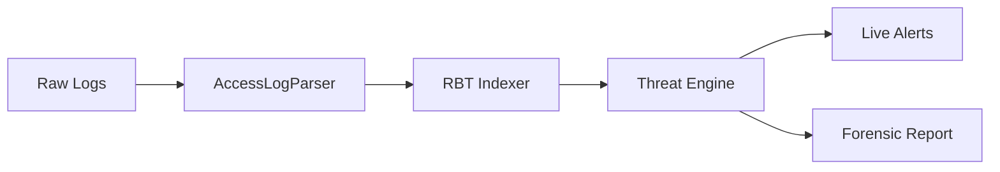

# 🕵️ Security Log Analyzer (SLA)

[](https://opensource.org/licenses/MIT)
[](https://github.com/likhith1253/SecurityLogAnalyzer)
[](docs/)

## Project Overview

**Security Log Analyzer (SLA)** is a high-performance forensic tool designed to automate the detection of cyber threats within server access logs. By combining heuristic risk scoring with efficient data structures like Red-Black Trees, SLA enables security investigators to identify malicious actors, trace attack vectors, and enforce real-time IP blacklisting with minimal manual intervention.

## 🚀 Key Value Proposition
- **Automated Intelligence**: Converts raw, noisy log data into actionable threat intelligence.
- **Sub-Second Performance**: Leverages self-balancing trees for efficient querying of massive datasets.
- **Forensic Accuracy**: Detects sophisticated attack patterns beyond simple status code monitoring.

## 🛠️ Tech Stack

| Component | Technology |
| :--- | :--- |
| **Language** | Java 11+ |
| **Data Structures** | Red-Black Tree (Self-Balancing BST) |
| **Core Engine** | Heuristic Threat Analysis System |
| **Security** | XOR Encryption, Role-Based Access Control |
| **Configuration** | Properties-based Environment Tuning |

## 🏗️ High-Level Architecture

The system follows a Pipeline-and-Filter architecture, transforming raw logs into structured insights.

1. **Ingestion**: Standardized parsing of log formats.
2. **Analysis**: Scoring engine evaluates risk based on resource sensitivity and attack signatures.
3. **Database**: Persistent storage for blacklists and suspicious IP history.
4. **Reporting**: Multi-format reporting for forensic evidence.

> [!IMPORTANT]
> For a deep dive into the system design, view the [Full Architecture Documentation](docs/architecture.md).

## 📊 Visual Processing Flow



## 👣 Quick Start Summary

```bash
# Compile and Run
javac -encoding UTF-8 -d . SecurityLogAnalyzer.java com/sla/app/*.java ...
java SecurityLogAnalyzer

# Log in (Default credentials available in users.csv)
# Username: admin
# Password: adminpass
```

See [Setup Guide](docs/setup.md) for detailed installation steps.

## 🛡️ Real-World Usage Example

During a simulated SQL injection attempt, the analyzer identified a malicious IP from a known high-risk range, assigned it a risk score of 0.95, and blocked it before the attack escalated.

```text
🚨 LIVE ALERT: IP 192.168.1.10 crossed threat threshold!
- Detected Path: /api/users?id=1' OR '1'='1
- Action: IP added to dynamic blacklist.
```

## 📬 Contact & Portfolio

- **GitHub Repository**: [SecurityLogAnalyzer](https://github.com/likhith1253/SecurityLogAnalyzer)
- **LinkedIn**: [Your Profile Link]
- **Documentation Credits**: Technical Documentation Engineer Assistant

## 🔮 Future Enhancements
- [ ] Integration with ELK Stack (Elasticsearch/Logstash/Kibana).
- [ ] Support for JSON/Structured logging formats.
- [ ] Machine Learning based anomaly detection for zero-day threats.
- [ ] Web Dashboard for interactive visualization.
