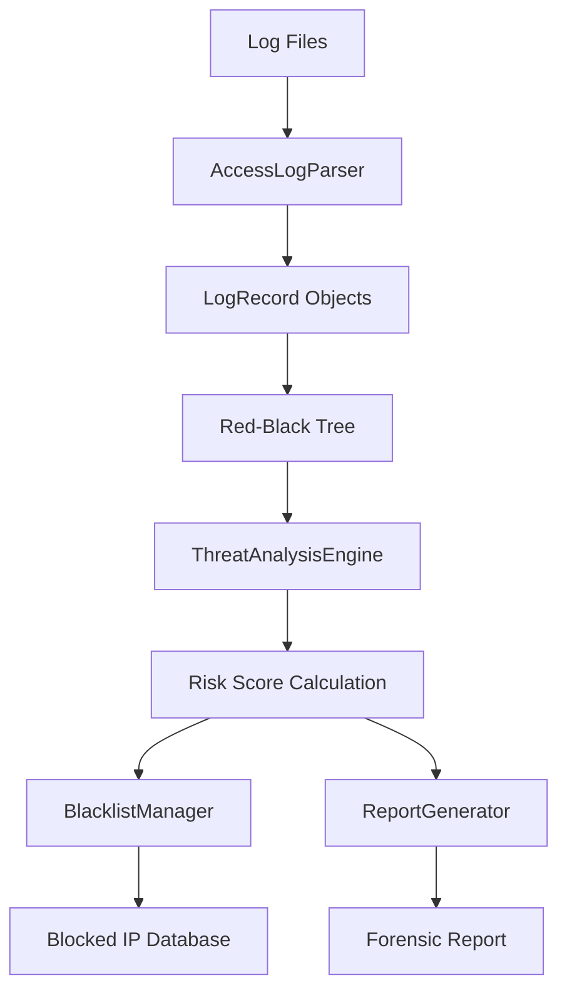

# System Architecture

The **Security Log Analyzer (SLA)** is designed with a modular architecture to ensure scalability, maintainability, and efficient processing of high-volume log data. The system utilizes advanced data structures and a multi-phase processing pipeline to detect security threats in real-time.

## Component Breakdown

### 1. Log Ingestion Module
Responsbile for reading raw log files and converting them into structured data.
- **AccessLogParser**: Parses standard HTTP access logs into `LogRecord` objects.
- **Data Models**: Standardized representation of log entries, geolocation data, and user information.

### 2. Processing & Analysis Engine
The core intelligence of the system.
- **ThreatAnalysisEngine**: Evaluates each log record against security heuristics and calculates risk scores.
- **BlacklistManager**: Manages a dynamic list of blocked IPs, persisting data across sessions.
- **Self-Balancing Search Tree (Red-Black Tree)**: Stores log records in a sorted manner to support efficient range queries and fast lookups.

### 3. Output & Reporting
Generates human-readable insights and machine-readable data.
- **ReportGenerator**: Produces detailed forensic reports including threat summaries and IP activity traces.
- **Console UI**: Provides an interactive interface for administrators to monitor alerts and perform manual queries.

## Module Interaction

The following diagram illustrates how the components interact during a forensic analysis:

[Architecture Diagram](images/architecture_diagram.md)

## Data Structures
- **Red-Black Tree**: Used for `LogRecord` storage to ensure $O(\log n)$ performance for insertions and $O(\log n + k)$ for range queries.
- **Hash Maps**: Used for quick lookups of geolocation data and risk score tracking.
