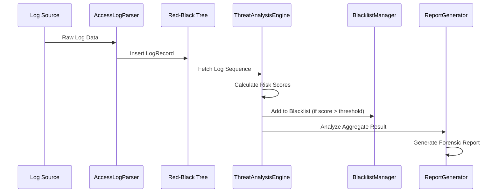

# Log Processing Flow

The Security Log Analyzer follows a structured multi-phase pipeline to transform raw log data into actionable security intelligence.

## Pipeline Overview

1. **Ingestion**: Raw log files are loaded and parsed into memory.
2. **Indexing**: Data is stored in a Red-Black Tree for efficient temporal searching.
3. **Scoring**: Each log entry is analyzed by the `ThreatAnalysisEngine` to calculate IP risk scores.
4. **Enforcement**: IPs crossing the threat threshold are dynamically blacklisted.
5. **Reporting**: Results are aggregated and exported to a forensic report.

## Step-by-Step Breakdown

### Phase 1: Ingestion & Parsing
The `AccessLogParser` iterates through the source log file. It uses regular expressions to extract:
- Source IP Address
- Timestamp
- HTTP Method and Request Path
- HTTP Status Code
- Metadata/Details

### Phase 2: Feature Extraction
The analyzer examines the request path and message details for security indicators:
- **Resource Sensitivity**: Is the user requesting `.env`, `/etc/passwd`, or other protected files?
- **Attack Signatures**: Does the request contain SQL injection strings or path traversal sequences (`../`)?
- **Authentication Failures**: Does the log record a `401 Unauthorized` or a failed login attempt?

### Phase 3: Risk Scoring & Alerting
Risk scores are cumulative per IP. Each suspicious event adds weight:
- **Confidential Access**: +0.30 points
- **Attack Payload**: +0.25 points
- **Failed Login**: +0.15 points
- **Server Error (5xx)**: +0.10 points
- **Client Error (4xx)**: +0.05 points

If an IP score exceeds the threshold (default `0.85`), a `LiveAlertCallback` is triggered, and the IP is blacklisted.

### Phase 4: Final Reporting
The `ReportGenerator` compiles all data points into a final forensic document, highlighting:
- Total logs processed.
- Summary of blacklisted IPs.
- Most dangerous IP identification.
- Regional threat distribution.

## Data Flow Diagram

[Log Flow Diagram](images/log_flow_diagram.md)

